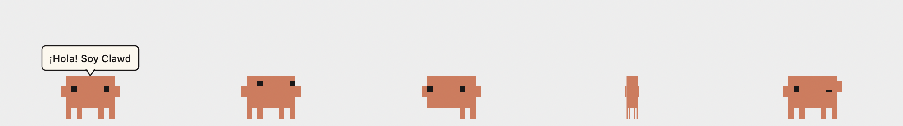
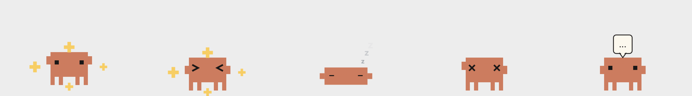
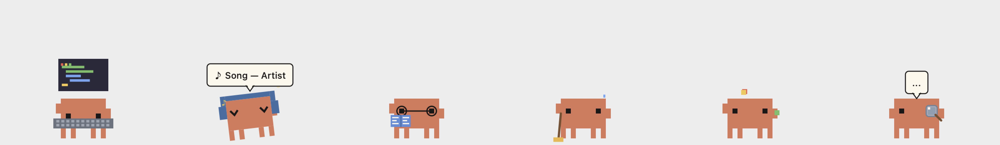
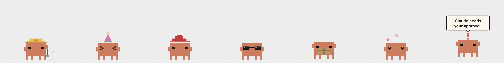

# Clawd Pet ✦

A tiny desktop pet for macOS: Clawd, the pixel mascot from Claude Code, lives on top of
your windows. It wanders around the screen, walks on your windows, looks at your cursor,
sleeps when you leave, comments on the apps you open and starts "typing" when Claude Code
is working.






This is a fan project. It is not affiliated with or endorsed by Anthropic.

## Requirements

- macOS 13 or newer (Apple Silicon or Intel).
- Xcode Command Line Tools, for the Swift compiler. Install them with:

```bash
xcode-select --install
```

No Accessibility or Screen Recording permission is needed. The first time Apple Music or
Spotify is open, macOS asks once whether Clawd may ask them what is playing; that is only
used to dance along.

## Build and run

```bash
git clone https://github.com/Diego-lii/clawd-pet.git
cd clawd-pet
./build.sh
open ClawdPet.app
```

`build.sh` compiles `main.swift` and signs the app with an ad-hoc signature, which macOS
requires to launch it from a launch agent.

Clawd does not show up in the Dock. To quit it, click the `✦` icon in the menu bar
(top right) and choose **Quit Clawd**, or right-click Clawd itself.

If you want Clawd in your Applications folder:

```bash
cp -R ClawdPet.app ~/Applications/
```

## Start at login

Create a launch agent that starts Clawd every time you log in (adjust the path if you
put the app somewhere else):

```bash
cat > ~/Library/LaunchAgents/dev.clawdpet.app.plist <<EOF
<?xml version="1.0" encoding="UTF-8"?>
<!DOCTYPE plist PUBLIC "-//Apple//DTD PLIST 1.0//EN" "http://www.apple.com/DTDs/PropertyList-1.0.dtd">
<plist version="1.0">
<dict>
  <key>Label</key><string>dev.clawdpet.app</string>
  <key>ProgramArguments</key>
  <array><string>$HOME/Applications/ClawdPet.app/Contents/MacOS/ClawdPet</string></array>
  <key>RunAtLoad</key><true/>
</dict>
</plist>
EOF
launchctl bootstrap gui/$(id -u) ~/Library/LaunchAgents/dev.clawdpet.app.plist
```

To remove it again:

```bash
launchctl bootout gui/$(id -u) ~/Library/LaunchAgents/dev.clawdpet.app.plist
rm ~/Library/LaunchAgents/dev.clawdpet.app.plist
```

## Updating

New versions are published as [releases](https://github.com/Diego-lii/clawd-pet/releases).
Clawd checks for a new release once a day (and on demand from the menu: **Check for
updates…**). When there is one, it says so in a speech bubble; click Clawd within
30 seconds to open the download page. The check only fetches the latest release tag from
GitHub and sends nothing about you. To update your copy:

```bash
cd clawd-pet
git pull
./build.sh
```

Then quit Clawd (menu bar `✦` → Quit Clawd) and open the new `ClawdPet.app`. If you copied
it to Applications and set it to start at login, replace it and restart the agent:

```bash
rm -rf ~/Applications/ClawdPet.app && cp -R ClawdPet.app ~/Applications/
launchctl kickstart -k gui/$(id -u)/dev.clawdpet.app
```

## What Clawd does on its own

The expressions come from the official `/buddy` system inside Claude Code (open eyes,
looking left and right, closed eyes, wink; arms down, up or one up; running legs) plus
the animations popular in the community (happy `> <`, dizzy `x x`, flat sleeping with Zs,
thinking with "...").

- Wanders freely to any point on the screen and turns around when it changes direction.
- Every now and then runs to the top edge of an open window and walks along it.
- If you move or close the window it is standing on, it falls to the next one (or the
  bottom of the screen). A long fall makes it dizzy.
- Waves with one arm, celebrates with both arms and sparkles, thinks with a magnifier, sleeps.
- Reads a book with round glasses, sweeps the floor with a broom, juggles three balls.
- Hides behind a screen edge and peeks back in ("Peekaboo!").
- Carries a cardboard box when it runs to a window.
- Wears a hat if you pick one from the menu: hard hat (and it hammers things now and then),
  party hat, Santa hat or sunglasses. "Automatic" means a Santa hat in December only.
- Says short phrases in a speech bubble. Its eyes follow the cursor and it blinks.

## How it reacts to your environment

| Situation | Reaction |
|---|---|
| The cursor rushes past it | Gets startled ("!") and runs away |
| The cursor rests on it for a second | Gets petted: closes its eyes and little hearts float up |
| The cursor stays still nearby for a while | Walks over to take a look ("Hmm?") |
| You drag it around very fast | Gets dizzy |
| You do not touch the Mac for 2.5 minutes | Falls asleep; wakes up startled when you come back |
| You switch to Claude, Xcode, VS Code, Terminal, a browser, Slack... | Comments on it |
| A song is playing in Apple Music or Spotify | Puts on headphones and dances, with the song title; keeps dancing now and then while the music plays |
| It is late at night | Sleeps more often |
| On launch | Greets you according to the time of day |
| Battery below 15 % and not charging | Warns you |
| Claude Code is working in a session | Sits at a laptop and types, with code appearing on the screen; celebrates when the session goes quiet |
| Claude Code needs your approval, or is waiting for you (alerts on) | Jumps with a red "!" and a sound until you click it or answer Claude |

Claude Code detection watches the session logs in `~/.claude/projects`. Nothing is read
or sent anywhere; only the timestamps of file changes matter. Music detection asks Apple
Music and Spotify through AppleScript, every 3 seconds, only while they are open.

## Do not disturb, sounds and hats

- **Do not disturb** (menu): Clawd walks to the bottom-right corner and stays quiet: no
  wandering, no speech bubbles, no sounds. Claude Code alerts only show the red "!" badge.
  Useful while presenting or recording the screen.
- **Sounds** (menu): short system sounds when you click it, when it lands, celebrates or
  alerts you. Off with one click.
- **Hat** (menu): automatic, none, hard hat, party hat, Santa hat or sunglasses.

These choices are remembered between launches.

## Claude Code alerts

Turn them on from the menu (**Claude Code alerts: turn on**) or from a terminal:

```bash
~/Applications/ClawdPet.app/Contents/MacOS/ClawdPet --install-hooks
```

This adds two hooks to `~/.claude/settings.json` (`Notification` for `permission_prompt`
and `idle_prompt`, and `Stop`), pointing at a six-line shell script in `~/.clawdpet/`. The
script appends each event to `~/.clawdpet/events.jsonl`, which Clawd reads. Your previous
settings are backed up once as `settings.json.before-clawdpet`. Everything stays on your Mac.

With the alerts on:

- When Claude Code waits for a permission, Clawd jumps with a red "!" and plays a sound,
  and repeats the message every 10 seconds. Click Clawd, answer Claude, or wait 3 minutes.
- When Claude Code has been idle waiting for your input, Clawd tells you.
- When a Claude Code turn that took a while ends, Clawd celebrates.

Turn them off from the same menu item, or with `--remove-hooks`.

## Controls

| Action | Result |
|---|---|
| Click | Happy `> <` eyes and a little hop |
| Double click | Celebrates with sparkles |
| Click while asleep | Wakes up |
| Drag and drop | Stays where you drop it (on the edge of a window, it stands on it) |
| Right click | Menu: wave, say something, go to a window, celebrate, sleep / wake up, come to the center, do not disturb, hat, sounds, Claude Code alerts on/off, check for updates, quit |
| `✦` icon in the menu bar | The same menu |

Only the body catches clicks. The transparent area around it lets clicks through to the
windows underneath.

## Language

Clawd speaks English. If your Mac's language is Spanish, it speaks Spanish instead.
Both sets of phrases live in `main.swift` (`phrases`, `clickPhrases` and the
`spanishText` table), so adding another language is a matter of editing that table.

## Customizing

Everything is in a single file, `main.swift`:

- `phrases` and `clickPhrases`: what it says.
- `orange`, `ink`, `cream`, `spark`: colors.
- `PetView.u`: pixel size (6 by default). Change it to make Clawd bigger or smaller.
- `pickBehavior()`: how likely each behavior is.
- Walking speed: the `42` (walk) and `120` (run) in `let speed`.

After editing, run `./build.sh` again and relaunch the app.

## Windows and Linux

Clawd Pet is a native macOS app written in Swift with AppKit, so it does not run on
Windows or Linux as is. The things it relies on are macOS-only: transparent floating
windows, the menu bar item, the list of open windows, idle-time detection, the battery
status and the FSEvents watcher.

If you want the same pet on Windows, the drawing and the behaviors are small and well
documented in `main.swift`, so porting is mostly a matter of replacing those platform
pieces. A port would need:

- A transparent, always-on-top, borderless window: in Python, `tkinter` with
  `-transparentcolor` and `-topmost`; in C#, a WPF window with `AllowsTransparency`;
  or an Electron/Tauri window with `transparent: true` and `alwaysOnTop: true`.
- The 11 x 8 pixel grid at the top of `main.swift` (the shape is the same everywhere).
- Open windows and their positions: `EnumWindows` + `GetWindowRect` from the Win32 API.
- Idle time: `GetLastInputInfo`. Battery: `GetSystemPowerStatus`.
- Claude Code activity: watch `%USERPROFILE%\.claude\projects` for `.jsonl` changes.
- Start at login: a shortcut in the Startup folder (`shell:startup`) or a Task Scheduler
  entry.

Contributions with a Windows or Linux port are welcome.

## Credits

- Clawd's shape comes from the `clawd.svg` shipped with the Claude Code VS Code extension,
  and the expressions from the `/buddy` system in Claude Code.
- Extra animations were inspired by [clawd-on-desk](https://github.com/rullerzhou-afk/clawd-on-desk)
  and [Clawd Mochi](https://github.com/yousifamanuel/clawd-mochi).

## License

MIT. See [LICENSE](LICENSE).
